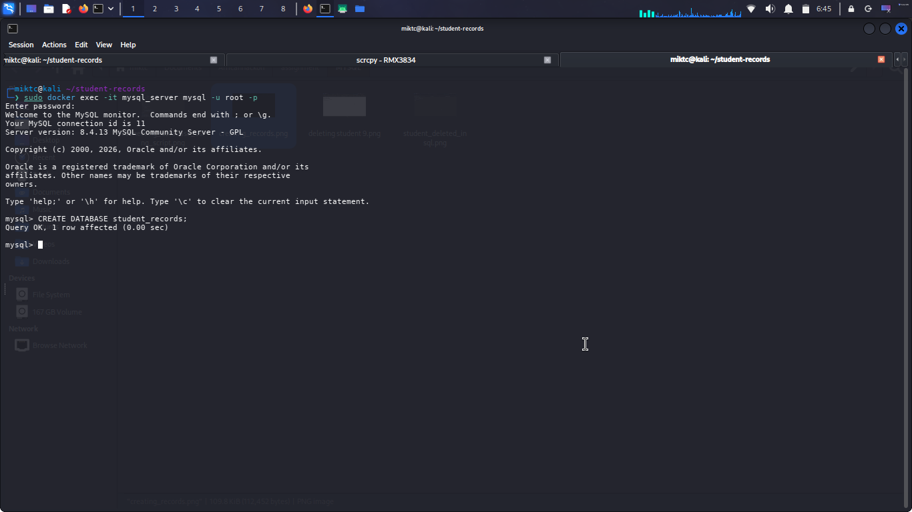
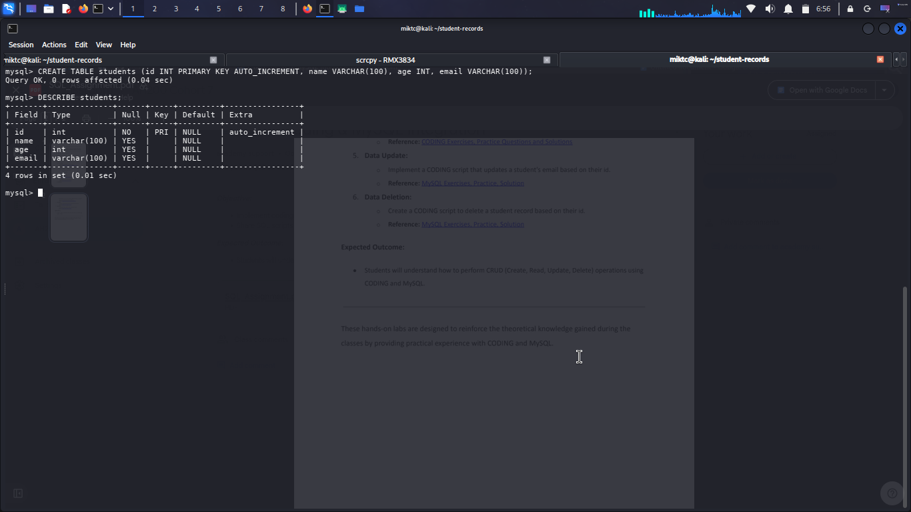
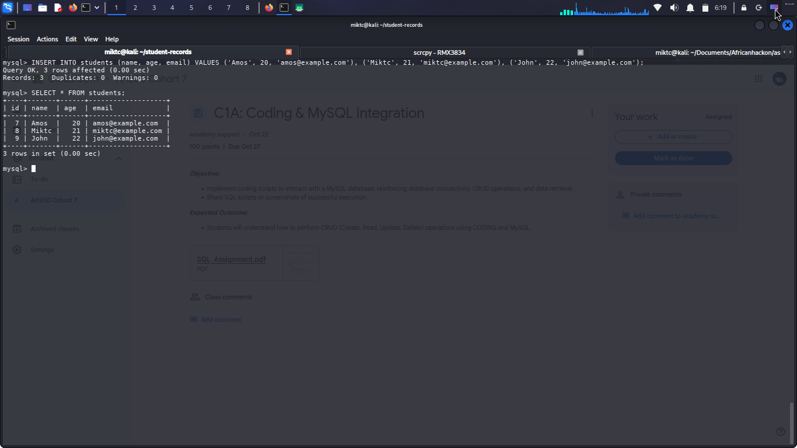
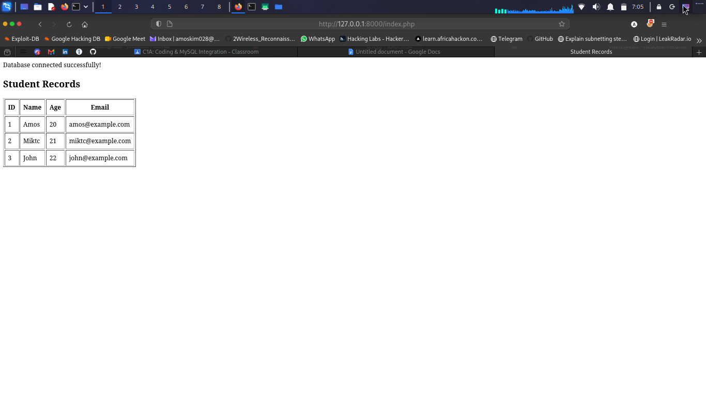
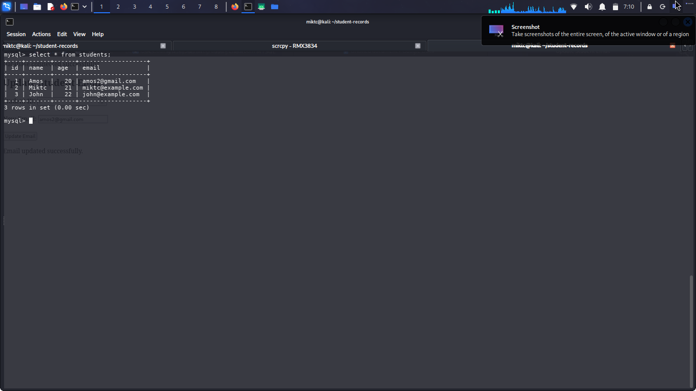

# MySQL Student Database Management

## Project Overview
This project demonstrates practical SQL skills using MySQL to create and manage a student database. It was completed as part of a database assignment.

## Technologies Used
- MySQL 8.4
- SQL
- Docker
- Linux

## Operations Performed
- Database creation
- Table creation
- Student data insertion
- Data retrieval using `SELECT`
- Updating a student's email using their ID

## Screenshots and Evidence

The screenshots below document the SQL operations performed during the assignment.

### 1. Database Creation

### 2. Table Creation

### 3. Data Insertion

### 4. Data Retrieval

### 5. Data Update

## Relevance to Cybersecurity
Databases store information that must be protected against unauthorized access and modification. Understanding SQL helps cybersecurity practitioners assess database access controls, maintain data integrity, and understand risks such as SQL injection.

## Learning Outcomes
Gained practical experience creating databases, managing records, retrieving information, and updating data using SQL.

## Conclusion
This project establishes a foundation in relational database management and supports further learning in database security and secure application development.
